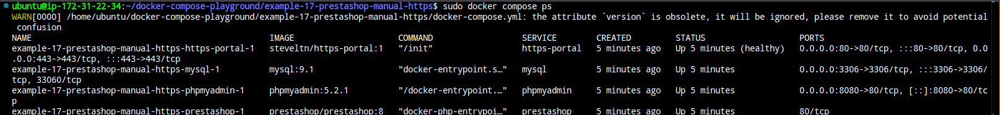
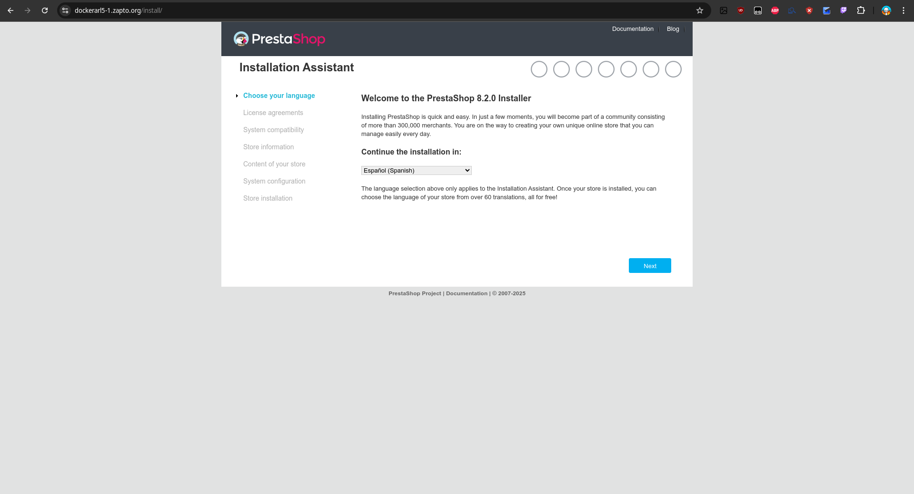
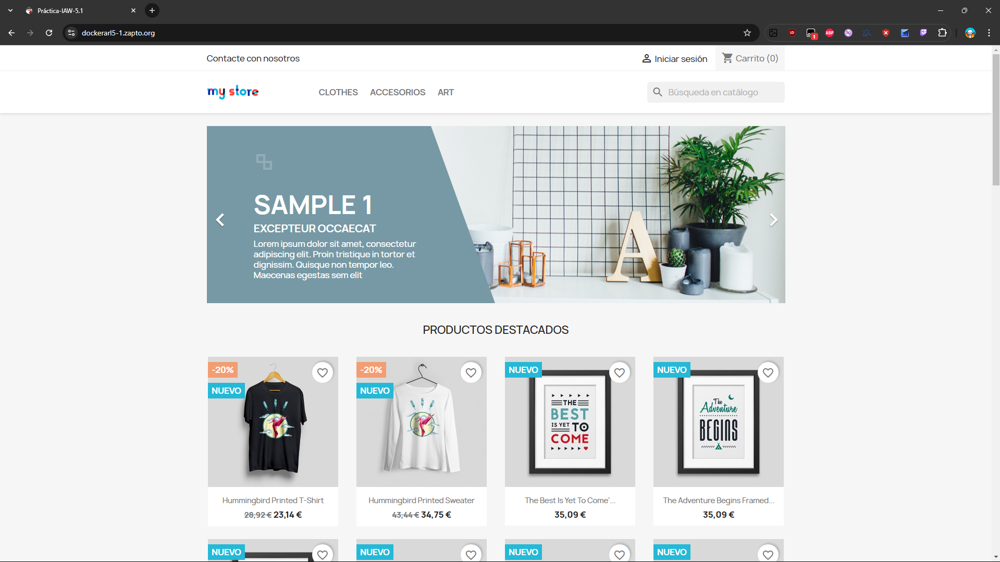

# Practica-IAW-5.1- HTTPS con Let’s Encrypt y prestashop, Docker y Docker Compose

## Comandos usados para levantar los contenedores y borrarlos


```bash
sudo docker compose up -d
```

```bash
sudo docker compose down -v
```




